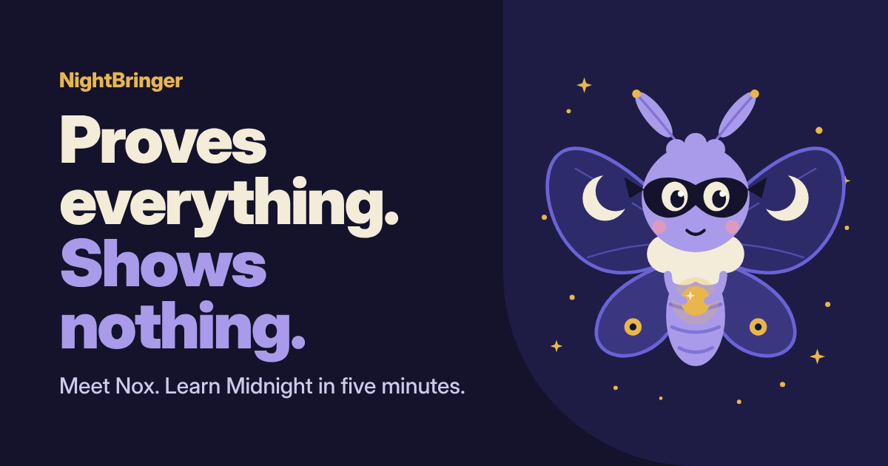

<p align="center">
  
</p>

# NightBringer

**NightBringer** is a community memecoin with one job: help more people understand [Midnight](https://midnight.network), the privacy blockchain where you can prove things without exposing your data.

Its mascot is **Nox, the masked night moth**. Every part of him explains a Midnight idea:

| Nox | Midnight idea |
| --- | --- |
| The mask | Privacy by default |
| Folding wings | Selective disclosure: show only what's needed |
| The golden orb | A zero-knowledge proof: prove it without revealing it |
| The dust | NIGHT generates DUST, the shielded resource that pays fees |
| Crescent moons | Midnight's roadmap phases are named after moon phases |

**Website:** https://OWNER.github.io/REPO/

> **Fan-made.** NightBringer is not affiliated with, endorsed by, or connected to Midnight, the Midnight Foundation, or Input Output. It is not NIGHT and does not generate DUST. Read the [disclaimer](DISCLAIMER.md).

---

## Official token details

| | |
| --- | --- |
| Ticker | _Not announced yet_ |
| Chain | Cardano |
| Policy ID | _Not announced yet_ |
| Total supply | _Not announced yet_ |

**The policy ID is the only reliable way to identify the token.** Names and logos can be copied. Until a policy ID appears here and on the website, any token using the NightBringer name or Nox is not ours.

## Official channels

_Listed here at launch._ Until then, any account claiming to be NightBringer isn't us. See [SECURITY.md](SECURITY.md).

---

## What's in this repo

```
site/                       The website, deployed to GitHub Pages
  index.html                Home: interactive Nox, token, roadmap, safety, community
  midnight.html             Midnight 101: plain-language explainer
  brand.html                Brand kit: downloads, colors, type, usage rules
  404.html                  "Shielded" not-found page
  assets/js/config.js       ← token details and links live here
  assets/js/main.js         Fills the page from config.js, wing toggle, copy buttons
  assets/css/style.css      Styles and brand tokens
  assets/brand/             Nox artwork: SVG masters and png/ exports
  assets/og.png             Social preview image (1200 × 630)
.github/workflows/pages.yml Deploys site/ to GitHub Pages on every push to main
.github/ISSUE_TEMPLATE/     Meme submission, impersonator report, fact correction
BRAND.md                    Colors, type and mascot rules
CONTRIBUTING.md             How to submit memes, translations and fixes
SECURITY.md                 Impersonation and vulnerability reports
DISCLAIMER.md               Read before buying anything
LICENSE                     MIT (code)
LICENSE-ART.md              CC BY 4.0 (Nox artwork)
```

The site is plain HTML, CSS and a little JavaScript. No build step, no dependencies. Only `site/` is published; the repo docs stay on GitHub.

## Launch checklist

1. **Create the repository** on GitHub (public) and push this repo to the `main` branch.
2. **Turn on Pages:** *Settings → Pages → Build and deployment → Source: **GitHub Actions***. The workflow publishes `site/` on the next push (or run it by hand from the *Actions* tab).
3. **Replace the placeholders.** Link previews, the 404 page and the GitHub links use the placeholders `OWNER` (your GitHub username or organization) and `REPO` (the repository name). From the repo root:

   ```bash
   # example: github.com/nightbringer-xyz/nightbringer
   grep -rlE "OWNER|REPO" site | xargs sed -i -e 's/OWNER/nightbringer-xyz/g' -e 's/REPO/nightbringer/g'
   ```

   On macOS use `sed -i ''` instead of `sed -i`. Then fix the **Website** link near the top of this README by hand.
4. **Fill in [`site/assets/js/config.js`](site/assets/js/config.js)** when you have them: ticker, policy ID, supply, launch date, explorer and swap links, social links.
5. Update the **Official token details** and **Official channels** sections of this README at the same time, so both places always match.
6. **Protect `main`** and turn on two-factor authentication (see [SECURITY.md](SECURITY.md)). A change to `config.js` changes where people send money.

### How `config.js` drives the site

- Empty values show "Not announced yet", and empty links are hidden instead of broken.
- Once `policyId` is set, the token section swaps its "not launched yet" warning for "check the policy ID every time" and shows a copy button.
- Community buttons appear one by one as you add their links.

### Custom domain (optional)

1. Add the domain under *Settings → Pages → Custom domain*, and point your DNS at GitHub Pages ([GitHub's guide](https://docs.github.com/en/pages/configuring-a-custom-domain-for-your-github-pages-site)).
2. Replace `https://OWNER.github.io/REPO/` with `https://your-domain/` in the `site/` files and this README.
3. Tick **Enforce HTTPS**.

## Preview locally

```bash
python3 -m http.server 8000 --directory site
# then open http://localhost:8000
```

The 404 page loads its styles from the live site address, so it only looks right once deployed.

## Brand kit and licensing

- **Code** (HTML, CSS, JS): [MIT](LICENSE).
- **Nox artwork** in `site/assets/brand/` and `site/assets/og.png`: [CC BY 4.0](LICENSE-ART.md). Remix freely; credit "Nox by NightBringer".
- Mascot rules: [BRAND.md](BRAND.md), or the brand kit page on the website.

## Contributing

Memes, translations, fact corrections and fixes are all welcome. Read [CONTRIBUTING.md](CONTRIBUTING.md) first.
